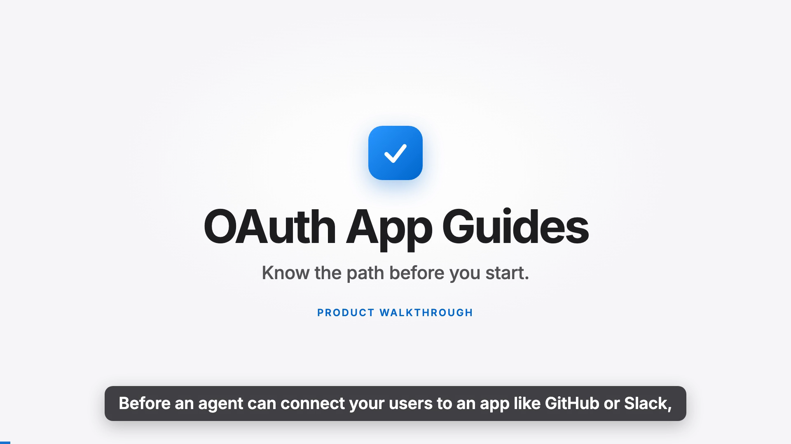

# Walkthrough

**[Watch the walkthrough on Google Drive](https://drive.google.com/file/d/1qOaZdI5aI4UnDNEglrV_l5E-hcp7LAqu/view?usp=sharing)** · 2:49 · 1080p · captions burned in · video by Ahad Nadeem

A tour of OAuth App Guides, start to finish: what a guide tells you, where each claim comes from, a real setup attempt, a live generation for an app with no ready-made guide, and how the project checks itself. Every screen recording in it is the real, deployed site at <https://composio-oauth-guides-lovat.vercel.app>.

## Chapters

| Time | Chapter | What you will see |
| --- | --- | --- |
| 0:00 | **The problem** | Why your own OAuth app, and the approval wait nobody can predict, slow agent integrations down. |
| 0:19 | **What a guide answers** | The three questions every guide answers, and the six ready-made guides. |
| 0:37 | **A curated guide, with its evidence** | GitHub: the verdict first, then effort, approval wait and blocker risk, each labeled for what it is, with the exact quote behind every step. |
| 1:13 | **Real setup attempts** | The published log of a real setup. The agent filled in the forms and stopped at every consent screen and terms checkbox. |
| 1:30 | **Live generation for any app** | Searching an app live: the agent finds the docs, reads them, checks Composio's catalog, probes for OAuth endpoints and verifies every quote, in about ten to fifteen seconds. Then a shareable link. |
| 2:01 | **Why you can trust it** | A plain AI's answers checked against the official pages, and the log of what we got wrong. |
| 2:25 | **Limits, and where to find it** | The honest limits, then the links. |

## What is real in the video

- **The site.** Recorded from the production deployment, driven by a script, not mocked up.
- **The live generation.** A genuine run against production, in real time: not sped up and not a replay. Linear had been generated before, so the recording asks the server for a fresh run, which is what happens the first time anyone searches an app. If you search Linear yourself you will get the saved guide instantly, and a new app takes about 10 to 20 seconds.
- **The setup attempts.** The logs shown are the ones published in [`public/evidence/`](public/evidence).
- **The voice.** A local AI voice (Kokoro, Apache 2.0). The narration is the transcript below.

## Transcript

**The problem**  
Before an agent can connect your users to an app like GitHub or Slack, you often need your own OAuth app with that provider. Sometimes the provider has to approve it, and nobody can tell you how long that takes. OAuth App Guides answers that, with the evidence attached.

**What a guide answers**  
Search any app, and you get three answers. Do I need my own OAuth app at all? How much work is it, and how long could approval take? And what can an agent do for me, versus where do I have to step in? Six guides are ready-made. Everything else is generated live.

**A curated guide, with its evidence**  
Take GitHub. The verdict comes first: no approval needed. Underneath are the effort, the approval wait, and the blocker risk, each labeled for what it is. The effort figure is our estimate, and it says so. Every step and every rule shows its source. Open one, and you see the exact words from GitHub's documentation, with the date we fetched it. A code check confirms each quote is really on that page, and a second check asks whether the quote actually supports the claim. Anything we could not verify is listed as a gap, on purpose.

**Real setup attempts**  
For GitHub, Google and Notion, we did not stop at the docs. We ran the real setup and published the log. The agent filled in the forms, and stopped at every consent screen and every terms checkbox, because only the account owner can accept those.

**Live generation for any app**  
Now an app with no ready-made guide. An agent finds the provider's documentation, reads it, checks Composio's catalog, probes for public OAuth endpoints, and verifies every quote, while you watch each step. In about fifteen seconds you get a shareable link. These guides are labeled as agent-generated and not human verified, and the gaps are shown, not hidden. Copy the link, or copy the whole guide as Markdown.

**Why you can trust it**  
Why trust it? This page shows our work. We asked a plain AI the same questions, with no sources, and checked its answers against the official pages. Most claims could not be confirmed, and a few were wrong. Slack's review wait, for example, was understated by an order of magnitude. There is also a log of what we got wrong along the way.

**Limits, and where to find it**  
It has limits. A guide is only as good as the pages the agent can find, and documentation behind a login cannot be read. The support check is itself a model, so it can be wrong. Everything is open source. Try it, or read the code, with the links on screen.
